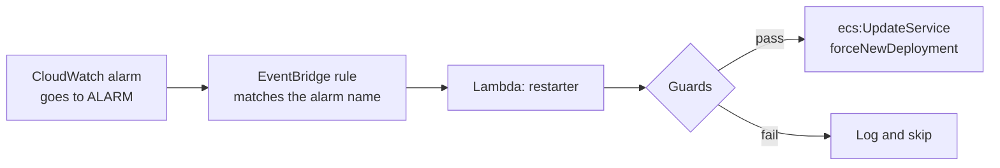

# AWS self-healing restarter

[](https://github.com/dineshravichandiran/aws-self-healing-restarter/actions/workflows/ci.yaml)
[](LICENSE)

A small AWS Lambda function that restarts an ECS service when a CloudWatch alarm goes into
`ALARM`. It is the "alarm, then automatic first response" step of an on-call setup, with guards so
it cannot make an outage worse.



## What it does and what it refuses to do

| Situation | Result |
|---|---|
| Alarm state is `ALARM` and the guards pass | Starts a rolling replacement of the service's tasks |
| Alarm state is `OK` or `INSUFFICIENT_DATA` | Ignored |
| A deployment is already rolling out | Skipped |
| Current deployment is newer than the cooldown (default 10 minutes) | Skipped, so a bad alarm cannot cause a restart loop |
| Service is draining or has no primary deployment | Skipped |
| Service does not exist | Raises an error, so it shows up in Lambda error metrics |
| `DryRun` is `true` (the default) | Logs `would_restart` and changes nothing |

Every decision is written to the logs as one JSON line.

## Safety choices

- **Dry run by default.** Deploy it, watch a few real alarms in the logs, then switch `DryRun` to `false`.
- **Least privilege.** The function can only call `ecs:DescribeServices` and `ecs:UpdateService`, and only on the one service ARN it was deployed for.
- **One at a time.** Reserved concurrency of 1 and a single retry, so two alarms cannot start two overlapping restarts.
- **Only named alarms.** The EventBridge rule matches the alarm names you list, not every alarm in the account.

## Deploy

Needs the AWS SAM CLI and an existing ECS service.

```bash
sam build
sam deploy --guided \
  --parameter-overrides ClusterName=<cluster> ServiceName=<service> AlarmNames=<alarm1>,<alarm2> DryRun=true
```

It pairs with the burn-rate alarms in [aws-sre-platform-terraform](https://github.com/dineshravichandiran/aws-sre-platform-terraform),
for example the composite alarm named `<name>-slo-page-fast`.

Try the handler locally with the sample alarm event:

```bash
sam local invoke RestarterFunction --event events/alarm.json
```

## Tests

```bash
pip install -r requirements-dev.txt
python -m pytest -q          # unit tests
cfn-lint template.yaml       # template lint
```

## What has been checked

| Item | Checked how |
|---|---|
| Handler logic: restart, ignore, dry run, cooldown, in-progress, draining, missing service | 9 unit tests using botocore's stubber, plus one against moto's in-memory ECS. Tests cover the handler module fully |
| SAM template | `cfn-lint` passes, in CI |
| Deployed to a real AWS account | **No.** The restart call has only been exercised against stubbed and mocked AWS, never a live service |

Before relying on it, deploy with `DryRun=true` and check the logs against a real alarm.

## Author

Dinesh Ravichandiran. GitHub: [dineshravichandiran](https://github.com/dineshravichandiran)

## License

Released under the [MIT License](LICENSE).
